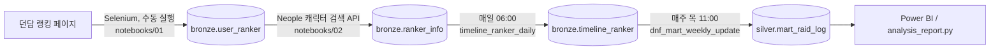
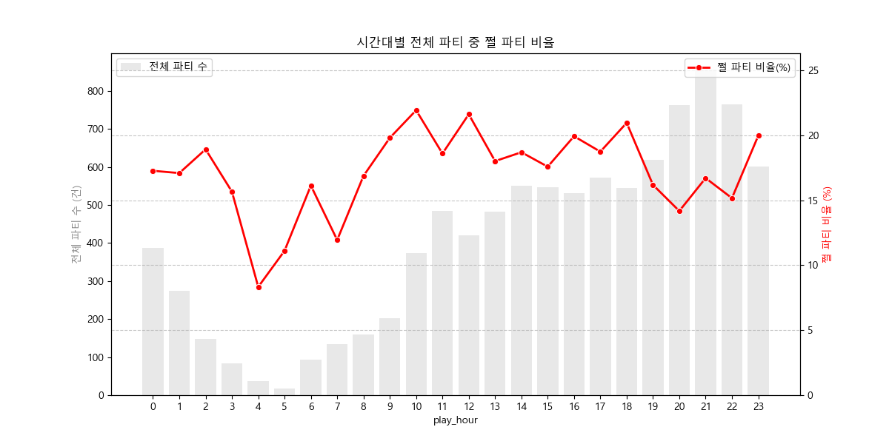
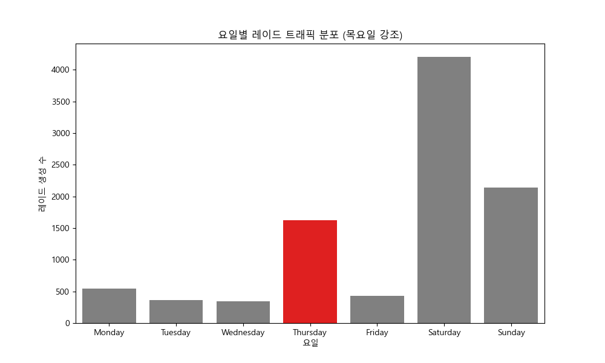

# 던전앤파이터 레이드 데이터 파이프라인

Neople Open API로 랭커 캐릭터의 타임라인을 매일 수집하고, 주 1회 레이드 분석용 마트로 변환하는 개인 프로젝트입니다.
Airflow(Docker)와 로컬 MySQL로 운영했고, Bronze → Silver 2단계로 저장했습니다.

- 운영 기간: `[작성 필요: 예) 2025.12 ~ 2026.01]`
- 분석 표본: 직업별 상위 20위 랭커, 레이드 기록 6,854건 (분석 시점 기준)
- 사용 기술: Python, SQL, Apache Airflow, MySQL, Power BI

## 파이프라인



| 단계 | 실행 | 파일 | 하는 일 |
|---|---|---|---|
| 마스터·랭커 목록 | 수동 (노트북) | `notebooks/01_*`, `notebooks/02_*` | 서버·직업 마스터를 적재하고, 던담에서 직업별 랭커를 수집한 뒤 API로 `characterId`를 붙여 `ranker_info`를 만듦 |
| 타임라인 수집 | 매일 06:00 | `dags/timeline_ranker_daily.py` → `scripts/ranker_timeline_loader.py` | 랭커별 전일 06:00 ~ 당일 05:59:59 타임라인을 API로 받아 Bronze에 upsert |
| 마트 변환 | 매주 목 11:00 | `dags/dnf_mart_weekly_dag.py` → `scripts/etl_mart_generation.py` | 레이드 이벤트(코드 201, 209)만 골라 JSON을 파싱하고, 요일·시간·쩔 파티 여부를 붙여 Silver에 적재 |
| 분석 | 수동 | `analysis/analysis_report.py` | 시간대별 쩔 파티 비율, 요일별 레이드 수 차트 생성 |

## 운영을 위해 넣은 설계

**1. 서버 점검 시 자동 재시도**
- 목요일 점검 중에는 API가 `503 / DNF980 SYSTEM_INSPECT`를 돌려줍니다.
- 이 응답만 따로 예외(`NeopleSystemInspect`)로 올려서 태스크를 실패시키고, Airflow가 30분 간격으로 최대 12회(6시간) 다시 돌리게 했습니다.
- 일반 오류는 해당 캐릭터만 건너뛰고 계속 진행합니다. 캐릭터 한 명의 오류로 전체 수집이 멈추지 않게 하기 위해서입니다.
- 코드: `scripts/ranker_timeline_loader.py`의 `_raise_if_system_inspect`, `main()`의 예외 처리 / `dags/timeline_ranker_daily.py`의 `default_args`

**2. 다시 돌려도 중복이 생기지 않는 적재**
- Bronze: `캐릭터ID|일시|이벤트코드|이벤트명`의 SHA-256 해시를 PK(`event_uid`)로 쓰고 `INSERT ... ON DUPLICATE KEY UPDATE`로 적재합니다. 재시도나 재실행으로 같은 구간을 다시 받아도 행이 늘지 않습니다.
- Silver: 대상 기간을 먼저 `DELETE`하고 다시 `INSERT`합니다. 같은 주를 다시 돌려도 결과가 같습니다.

**3. 게임 날짜 기준 수집 구간**
- 게임 안의 하루는 06:00에 바뀝니다. 그래서 DAG를 06:00에 돌리고, Airflow의 `data_interval_start/end`로 "전일 06:00:00 ~ 당일 05:59:59"를 계산해 넘깁니다.
- 재시도해도 실행 시각이 아니라 스케줄 구간 기준이라 수집 범위가 바뀌지 않습니다.

**4. 비밀값 분리**
- DB 접속 정보는 Airflow Connection(`mysql_conn`), API 키는 Airflow Variable(`NEOPLE_API_KEY`)에서 읽습니다. 로컬 실행 시에는 `.env`를 씁니다 (`.env.example` 참고).

**5. 오염된 원본 대응**
- `raw_json`이 정상 JSON, CSV식 이스케이프, 파이썬 dict 문자열로 섞여 들어온 경우가 있어서 순서대로 파싱을 시도하고, 끝까지 실패한 행은 건너뜁니다. 원본 코드를 다시 확인해 레이드가 아닌 이벤트가 섞이는 것도 걸러냅니다 (`scripts/etl_mart_generation.py`).

## 분석 결과 (요약)

| 시간대별 쩔 파티 비율 | 요일별 레이드 수 |
|---|---|
|  |  |

- 쩔 파티 비율은 오픈 직후(06시)나 저녁 피크보다 **10시, 12시, 18시**에 높았습니다. 콘텐츠가 끝나기 직전인 "막차" 시간대에도 비율이 높았습니다.
- 쩔 파티 여부는 파티 제목의 키워드(`쩔|손님|손|잠수|수금`)로 판단했습니다. 제목에 키워드가 없는 쩔 파티는 잡지 못합니다.
- **표본 한계**: 직업별 상위 20위 랭커만 대상이라 일반 유저의 패턴으로 보기는 어렵습니다.

## 폴더 구조

```
dags/            운영한 Airflow DAG 2개
scripts/         DAG가 호출하는 수집·변환 스크립트
notebooks/       마스터 테이블과 랭커 목록 구축 (수동 실행, 비밀값 제거·출력 삭제)
analysis/        분석 스크립트와 결과 차트
experimental/    랭커 목록 수집을 자동화하려던 미완성 DAG (아래 한계 참고)
```

## 실행 방법

1. Airflow 2.x를 Docker로 띄우고 `dags/`와 `scripts/`를 각각 `/opt/airflow/dags`, `/opt/airflow/scripts`에 마운트합니다.
2. Airflow에 Connection `mysql_conn`(MySQL)과 Variable `NEOPLE_API_KEY`를 등록합니다.
3. 노트북 01 → 02 순서로 실행해 `bronze.ranker_info`를 만듭니다.
4. `timeline_ranker_daily`, `dnf_mart_weekly_update` DAG를 켭니다.

> `docker-compose.yml`과 `silver.mart_raid_log` 테이블 DDL은 아직 저장소에 없습니다.

## 한계와 개선할 점

- **랭커 목록은 자동화하지 못했습니다.** 던담 랭킹 페이지가 JavaScript로 그려져서 노트북에서 Selenium으로 수동 수집했습니다. `experimental/`의 크롤러 DAG는 `requests`로 시도한 미완성 버전입니다. 저장 컬럼도 `ranker_info` 스키마(`serverId`, `characterId`)와 맞지 않아 운영에는 쓰지 않았습니다.
- **예외를 넓게 잡는 부분이 있습니다.** 파싱 단계에서 `except:`나 `except Exception`으로 넘기는 곳이 있어 오류 원인이 로그에 남지 않습니다. 건너뛴 건수를 집계해 로그로 남기는 방식으로 바꿀 계획입니다.
- **데이터 검증 단계가 없습니다.** 적재 후 건수 비교, NULL·중복 점검 같은 품질 체크를 별도 태스크로 넣으면 운영 안정성을 더 확인할 수 있습니다.
- 마트 조회 SQL에 날짜를 문자열로 바로 넣고 있습니다. 파라미터 바인딩으로 바꾸는 것이 안전합니다.
- 로컬 MySQL 기준입니다. 클라우드 DW로 옮기는 것은 하지 않았습니다.

## AI 도구 활용

`[작성 필요: 어떤 도구를 어디에 썼는지. 예) 수집 스크립트 초안은 AI 도구로 작성하고, 점검 응답 처리·수집 구간 계산·중복 방지 방식은 직접 정해서 수정함]`

---

<!--
게시 전 체크리스트 (이 주석은 지워도 됩니다)
- [ ] 운영 기간과 AI 도구 활용 내용 채우기
- [ ] silver DDL 추가: MySQL에서 SHOW CREATE TABLE silver.mart_raid_log; 결과를 sql/에 저장
- [ ] 가능하면 Airflow docker-compose.yml 추가
- [ ] 가능하면 Airflow UI의 DAG 실행 이력(성공·재시도) 스크린샷 추가
- [ ] Neople API 키 재발급 (예전 노트북에 키가 평문으로 들어 있었음)
-->
